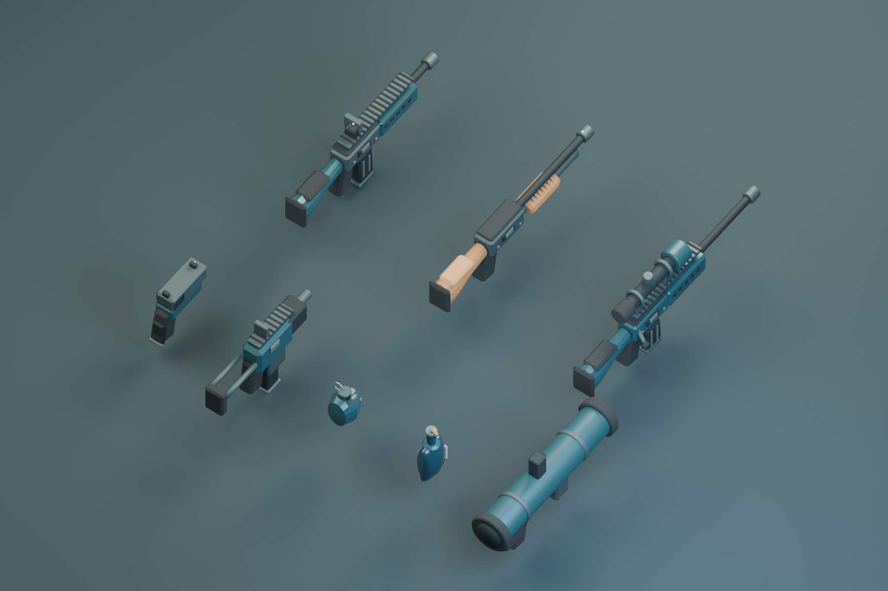

# Harbor Armory 6.2 · 两批武器升级

本轮完善现有的 8 种手持武器。所有模型均在 Blender 中制作，实际接入离线游戏。与之前的 14 个载具和港口道具合计，当前共有 22 个 Blender 模型。

## 第一批：三把主武器

| 武器 | 模型与动作 | 射击体验 |
| --- | --- | --- |
| AR-7 突击步枪 | 倒角枪身、护木、瞄具、独立弹匣与枪栓 | 连射散布、独立后坐力与恢复速度、短枪焰、弹壳、机械音 |
| PUMP 霰弹枪 | 木质枪托与护木、泵动循环、延后退壳 | 近距离集中伤害，10 米后渐进衰减，47 米处每弹丸伤害为近距离的 23%；同一目标的弹丸分组结算 |
| LONGWATCH 狙击枪 | 镜体、镜片、支架、枪栓与弹匣 | 拉栓和退壳节奏、独立枪声、较慢回稳、平滑进入 4x / 8x；保留屏息 |

霰弹枪逐发装填：每装入一发，弹匣与备用弹药立即按一发结算。有已装填弹药时，可开火中断装填；切枪也会停止装填。其他枪仍在完整换弹结束时补弹，中途切枪不会获得弹药。

## 第二批：副武器、投掷物与重武器

| 武器 | 模型与动作 | 效果 |
| --- | --- | --- |
| 9MM 手枪 | 枪套筒、握把、弹匣、瞄点 | 套筒后移、轻快回正、短枪焰与弹壳 |
| VECTOR 冲锋枪 | 紧凑机匣、枪托、弹匣、瞄具 | 快速机械循环、较小单发震动、独立连射声音 |
| PULSE 手雷 | 有体积的弹体、拉环、压柄 | 手部投掷跟随、可见飞行、按碰撞面反弹；延时爆炸保留 |
| EMBER 燃烧瓶 | 瓶体、瓶颈、纸标、布条 | 持握和飞行时火苗、落地碎片、分布火舌、余烬、柔边烟雾和消退焦痕；水面熄灭 |
| COMET 火箭筒 | 管体、端部护圈、握把、瞄具、可移动装填部件 | 枪口效果、可见火箭、柔边烟迹、分层爆炸 |

爆炸依次呈现短闪光、火团、向外扬尘、上升烟团与少量碎片。烟团和焦痕使用带顶点透明度的网格，边缘自然淡出，无外部贴图依赖。已有飞机导弹同样使用新的烟迹与爆炸显示。

## 通用反馈与一致性

- 持枪模型、手部 IK、枪口、抛壳点共用姿势计算。Blender 集合的 `joints` 中保存 `muzzle`、`eject`、`support` 挂点。
- 枪口到角色之间也进行遮挡检查，防止枪管穿出掩体后从另一侧射击。普通枪弹保持原有射线判定；手雷和火箭保持实体投射物。
- 港口集装箱、货箱碰撞体明确标记金属和木材。命中金属/护甲产生火花，木材产生木屑，混凝土产生碎屑粉尘，水面产生水花。
- 守卫增加短暂受击后仰和倒地显示。尸体是有限时长的视觉快照，死亡后立即退出原有碰撞、AI 和重复奖励判定。
- 所有视觉变化按固定模拟时间更新。暂停冻结特效，切换地区和重置会清理临时效果。
- 所有枪声为本地 Web Audio 合成，包括冲击声、低频主体与机械瞬态。未加入外部音频素材。

## 资源和编辑

- `art/harbor-armory.blend`：8 把武器的可编辑场景及总览。
- `tools/blender_armory.py`：原始模型制作脚本，复用港口模型导出器。
- `assets/armory/*.glb`：8 个可独立导入编辑器的 GLB。
- `assets/armory/armory-pack.js`：高低两级网格、材质及挂点，内嵌到 `index.html`。
- `armory.js`：共用姿势、武器机械循环、枪声、逐发装填、命中和有上限的特效池。
- `armory-effects.js`：枪口之外的爆炸、火焰、烟迹、柔边烟团和焦痕。

修改 Blender 源文件并保存后导出：

```sh
python3 tools/build_blender_assets.py --armory --export-only
node tools/verify_blender_assets.cjs --armory
```

从脚本重新制作整套模型、保存源文件并渲染总览：

```sh
python3 tools/build_blender_assets.py --armory --render
```

重建命令会重新生成 `.blend`；手动编辑的源文件请使用 `--export-only`。部件位置、材质和网格可直接编辑；修改枢轴时也要同步集合的 `joints` 元数据。

## 性能与验证

每把武器的高细节网格为 608–4,164 个三角形，低细节网格为 132–638 个三角形。超过 24 米、低画质或 CPU 兼容模式使用低细节网格；阴影使用简化网格。

| 视觉池 | 低画质 / CPU | 中高画质 |
| --- | --- | --- |
| 弹壳 | 14 | 48 |
| 火花、碎屑、粉尘 | 36 | 110 |
| 弹痕、水波、焦痕 | 12 | 42 |
| 倒地快照 | 2 | 5 |
| 爆炸视觉 | 4 | 10 |

这些上限只影响显示。投射物容量、爆炸和火区伤害继续由战斗逻辑管理，不会因为降低画质而删除有效弹药。重叠火区共用火苗细节预算，每个火区仍显示边界与火焰。

```sh
python3 build.py
node --check bundle.js
node tools/verify_blender_assets.cjs --armory
python3 tools/verify_all.py
python3 tools/verify_workshop_browser.py
python3 tools/benchmark_armory.py
```

实际检查结果和对应构建哈希见 `verification/RESULTS.md`。浏览器模拟触控和桌面低画质测试不代表实机手机性能认证。

本轮没有增加新的武器种类。消音手枪与烟雾弹作为后续玩法扩展，需单独接入听觉、视线和搜索行为。


