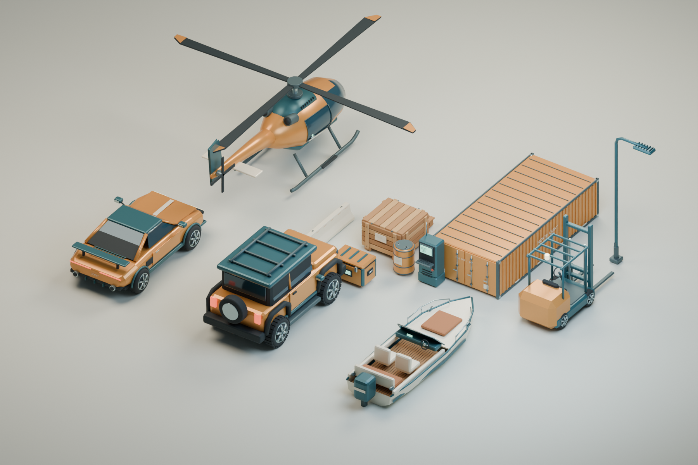
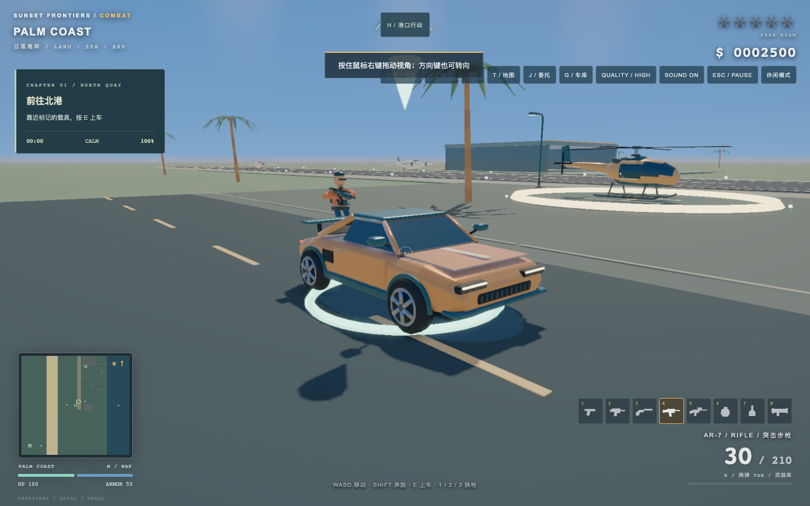
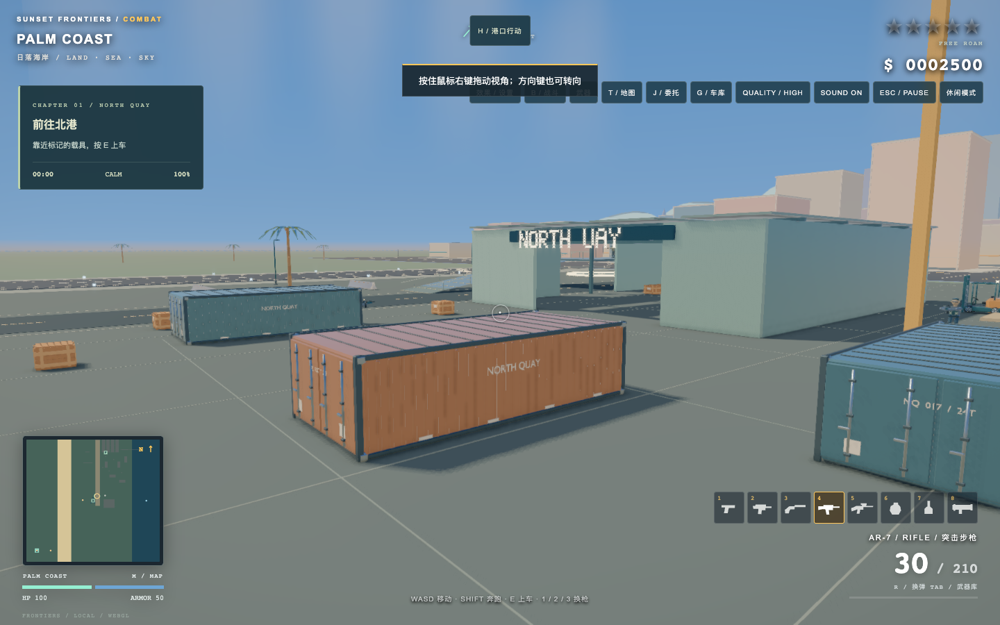

# Harbor Workshop：项目分析与模型升级

这次将最常接触的四种载具和十种港口道具做成了 Blender 模型，并接入实际游戏画面。风格是暖色车漆、深青色工业金属、烟蓝玻璃和木质货运设施，保持原有游戏的风格化比例。

## 原有画面的问题

项目使用自研 WebGL 渲染器，已有实例化、阴影和简化的 PBR 光照。限制主要在资产侧：游戏里的物体由少数基本几何体现场拼装，现有 `assets/*.glb` 只是导出样例，默认并没有参与游戏渲染。车身肩线、轮胎断面、门缝和机械连接缺少统一设计；材质的粗糙度和金属度按颜色推测，容易把偏蓝的橡胶或涂层识别成玻璃。

因此本次同时补齐了模型、材质和接入路径。没有把新 GLB 文件单独放进目录就视为完成。

## 已制作并接入的模型

| 类别 | 模型 | 主要细节 |
| --- | --- | --- |
| 陆地载具 | COMET 跑车 | 新车身轮廓、圆肩轮胎、轮毂、分体玻璃、后扩散器、灯带、可开合右车门 |
| 陆地载具 | TRAIL 越野车 | 全地形胎纹、轮眉、防撞杠、车顶行李架、备胎、踏板 |
| 空中载具 | OSPREY 直升机 | 曲面座舱玻璃、渐缩尾梁、涡轮罩、排气口、曲线滑橇、独立主/尾旋翼 |
| 水面载具 | STINGRAY 快艇 | V 形船底、开放座舱、柚木地板、座椅、风挡、护栏、舷外机 |
| 货运设施 | 集装箱、木箱、托盘、油桶 | 波纹板、锁杆、角件、绑带、木板分缝、桶口和卷边 |
| 码头设施 | 系船桩、路灯、护栏、叉车 | 缆绳、锚栓、弯管灯臂、灯罩、警示色、叉车门架与液压杆 |
| 任务物品 | 通讯终端、任务箱 | 屏幕、按键、设备通风口、锁扣、把手与状态显示 |

叉车是场景道具，四种原有载具继续使用原来的驾驶和损伤系统。人物、其他载具和大部分建筑继续使用原有模型，不代表全地图美术重制。



## 实际接入和性能处理

- 14 个模型均有高、低两级网格；远景和 CPU 兼容模式使用简化网格。
- 车轮滚动/转向、右车门和旋翼通过 Blender 中的独立部件及枢轴运动，跟随游戏状态并随暂停停止。
- WebGL 直接读取 Blender 材质的粗糙度、金属度和自发光属性；车库改色仍只修改车漆。
- 相同模型复用网格和实例缓冲，阴影使用简化模型，避免细节网格绘制两遍。
- 修正朝向、退化三角形和异常法线；低细节网格限制在源物体边界内。
- 网格内嵌到 `index.html`，直接打开文件和断网运行都不需要加载远程资源。独立 GLB 供编辑器使用。
- 新静态设施避开主路和任务门口；原有集装箱、货箱和路障的碰撞范围保持对应。




## 继续编辑

用 Blender 打开 `art/harbor-workshop.blend`。默认场景是模型总览，右上角场景选择器可切换到任意单个模型。保留物体的 `part_id`、集合中的枢轴信息以及材质的 `role`，修改并保存后运行：

```sh
python3 tools/build_blender_assets.py --export-only
node tools/verify_blender_assets.cjs
```

从脚本重新制作整套模型并渲染总览图：

```sh
python3 tools/build_blender_assets.py --render
```

上一个命令会重新生成 `.blend`；手工修改后的源文件应使用 `--export-only`。Blender 不在标准路径时设置 `BLENDER` 环境变量。

详细几何统计见 `assets/blender/manifest.json`，运行验证见 `verification/RESULTS.md`。本次采用材质色、真实网格和光照形成细节，没有制作纹理烘焙、骨骼角色动画或透明玻璃折射。

## 6.2 武器升级

后续两批已补齐 8 种手持武器的 Blender 模型、独立机械部件、共用枪口挂点、射击与换弹动作、分材质命中、爆炸和燃烧效果。详见 [武器升级与编辑说明](ARMORY_ZH.md)。源文件为 `art/harbor-armory.blend`，与港口场景源文件分别维护。
